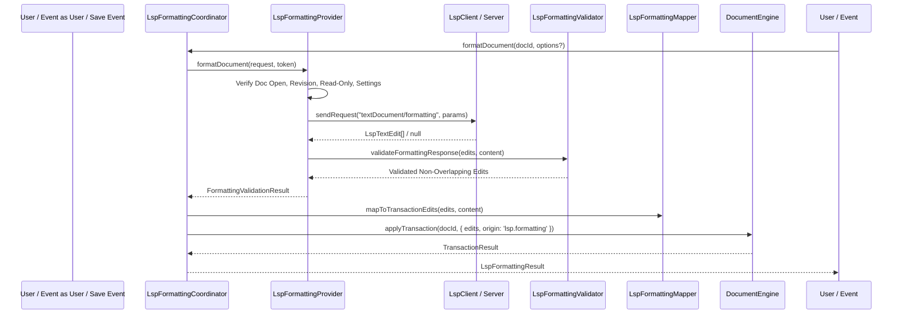

# QM Editor — LSP Formatting Architecture (Step 63)

## 1. Executive Summary

LSP Document Formatting (`textDocument/formatting`) and Selection/Range Formatting (`textDocument/rangeFormatting`) provide automated code aesthetic standardization across QM Editor. Following the architectural boundaries of Steps 56–62, formatting requests are issued directly to language servers through the `LspFormattingProvider` and coordinated via the `LspFormattingCoordinator`.

Every formatting operation applies its modifications through QM Editor's authoritative `DocumentEngine.applyTransaction()`, preserving undo/redo history, selection anchoring, dirty state tracking, and collaborative edit locks.

---

## 2. Protocol Integration & Registration

### 2.1 Supported LSP Methods
1. `textDocument/formatting`: Formats an entire document based on client-defined formatting options (`tabSize`, `insertSpaces`, `trimTrailingWhitespace`, `insertFinalNewline`, `trimFinalNewlines`).
2. `textDocument/rangeFormatting`: Formats a targeted selection or character slice within an open document.

### 2.2 Client Capabilities Advertisement
In `src/core/lsp/LspClient.ts`, client capabilities advertise:
```json
{
  "textDocument": {
    "formatting": {
      "dynamicRegistration": false
    },
    "rangeFormatting": {
      "dynamicRegistration": false
    }
  }
}
```

### 2.3 Server Capability Gates
Before dispatching a formatting request, `LspFormattingProvider` validates:
- For document formatting: `capabilities.documentFormattingProvider === true` or `{ workDoneProgress?: boolean }`.
- For range formatting: `capabilities.documentRangeFormattingProvider === true` or `{ workDoneProgress?: boolean }`.

If unsupported, an explicit notification status (`not_supported`) is emitted and user feedback is presented via `globalFeedbackService.showInfo()`.

---

## 3. Formatting Request & Response Pipeline



---

## 4. Concurrency, Race Conditions & Cancellation

1. **Pre-Flight Validation**: Documents that are closed, marked `isReadOnly`, or have missing language server sessions reject immediately with descriptive error statuses.
2. **In-Flight Mutation Protection**: If the document revision changes while an LSP formatting request is awaiting response, the edits are rejected immediately (`status: 'stale'`) to prevent stale edits from corrupting recent keystrokes.
3. **Workspace Generation Guard**: A switch in active workspace invalidates in-flight formatting requests.
4. **CancellationToken Propagation**: Requests subscribe to `CancellationToken` signals from user aborts or modal closures.

---

## 5. Architectural Non-Goals & Invariants

- **No Format On Save Loops**: Format on save executes before disk save without re-triggering file watchers or re-invoking recursive saves.
- **No Direct Buffer Slicing**: All content mutations pass through `DocumentEngine.applyTransaction()`. Direct string splicing or bypassing editor undo history is strictly prohibited.
- **No Background Disk Rewrites**: Unfocused or closed documents are never formatted behind the scenes.
