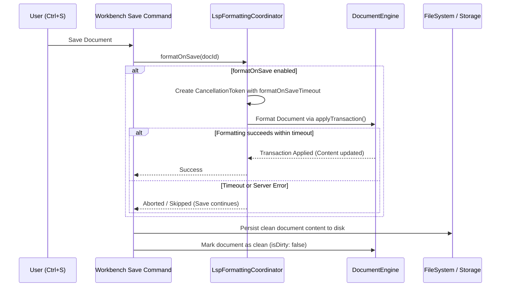

# QM Editor — LSP Format on Save Architecture (Step 63)

## 1. Overview

Format on Save automatically executes document formatting whenever a user initiates a file save (via `Mod+S`, Save All, or workbench commands). In QM Editor, format on save is governed strictly by user settings, cancellation timeouts, and document consistency barriers.

---

## 2. Configuration Settings

The following settings in `SettingsRegistry.ts` control format on save:

| Setting Key | Default | Description |
|---|---|---|
| `editor.formatOnSave` | `false` | When true, automatically formats the document before saving |
| `editor.formatOnSaveTimeout` | `2500` (ms) | Maximum wait duration before aborting format on save and continuing to save |
| `editor.formatOnSaveMode` | `'file'` | Formatting scope: `'file'` (entire document) or `'modifications'` |
| `lsp.formatting.enabled` | `true` | Master switch for LSP formatting capabilities |

---

## 3. Execution Pipeline & Save Lifecycle

---

## 4. Timeout & Fallback Safeguards

1. **Short Timeout**: The default format-on-save timeout is clamped (between 250ms and 10,000ms, default 2500ms).
2. **Non-Blocking Persistence**: If a language server hangs, crashes, or exceeds the timeout, the save command logs a warning and proceeds with persisting the user's unformatted document. Save operations are **never blocked or prevented** by server latency.
3. **No Save Recurse**: The formatting transaction applied during format-on-save is marked with origin `'lsp.formatting'`, preventing secondary save triggers or infinite loops.
