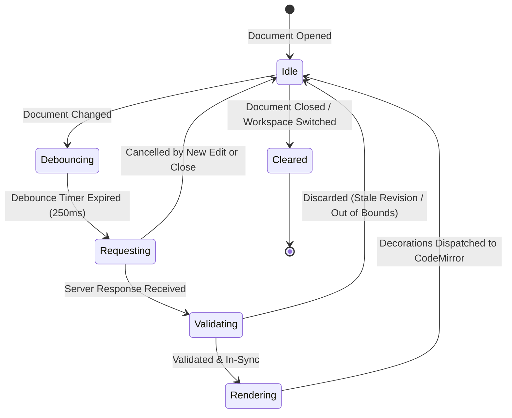

# QM Editor — LSP Inlay Hint Lifecycle & Invariant Governance
**Phase 06, Step 65 — LSP Inlay Hints, Parameter Names, Type Information & Inline Semantic Annotations**

---

## 1. Lifecycle State Machine

---

## 2. Invalidation & Refresh Triggers

1. **Document Opened (`document.opened`)**:
   Immediate request dispatched (`immediate: true`).
2. **Document Edited (`document.changed`)**:
   Prior in-flight `CancellationTokenSource` cancelled immediately. Debounce timer started (default 250ms). Once elapsed, a fresh request is sent with current document revision.
3. **Rapid Typing & Concurrency Guard**:
   If user edits during an active LSP query, the incoming response revision will not match `docRecord.contentRevision`, causing the response to be cleanly discarded.
4. **Document Closed (`document.closed`)**:
   Pending cancellation tokens cancelled, debounce timers cleared, memory cache released, and `hintsCleared` event emitted to editor view.
5. **Workspace Switch**:
   Active hints cleared; generation check prevents responses from superseded workspaces.
6. **Server Restart or Crash**:
   Active server session cleared, cache invalidated, re-requested once server enters `ready` state.
7. **Settings Toggle**:
   Toggling `lsp.inlayHints.enabled` off immediately clears hints across all open views; toggling on re-requests hints for open documents.

---

## 3. Invariant Checklist

- [x] Inlay hints never modify document buffers, lines, or character content.
- [x] Inlay hints do not advance document revision numbers.
- [x] Inlay hints do not create undo/redo history entries.
- [x] Inlay hints do not persist in storage, local history, or backups.
- [x] Coordinates outside document boundaries are quarantined and rejected non-fatally.
- [x] Server-provided text edits attached to hints are display-only and not automatically executed.
- [x] HTML and script tags in labels/tooltips are stripped to prevent XSS injection.
- [x] Hint decorations are sorted by document offset ascending for CodeMirror 6 engine requirements.
