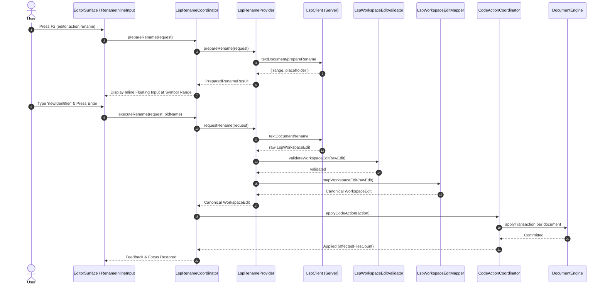

# QM Editor LSP Rename Integration Architecture
**Phase 06 — Advanced Features | Step 62 of 135**

---

## 1. Executive Summary

This document specifies the authoritative architecture for **Language Server Protocol (LSP) Rename and Prepare Rename Integration** in QM Editor. 

Building upon the LSP Foundation (Steps 56–58), Hover & Signature Help (Step 59), Code Navigation & References (Step 60), Workspace Symbol Search (Step 61), and the central Edit Transaction / Code Action infrastructure (Steps 27, 44), Step 62 delivers safe, transactional, single-file and cross-file symbol renaming across the editor.

---

## 2. Protocol Boundaries & Capabilities

QM Editor supports both two-phase preparation and direct rename requests compliant with LSP 3.17:

- `textDocument/prepareRename` (`PrepareSupport: true`):
  - Inquires whether the symbol at `(line, column)` can be renamed before opening UI prompts.
  - Returns either:
    1. Exact symbol range and placeholder (`{ range: Range, placeholder: string }`),
    2. Range only (`{ range: Range }`),
    3. Default behavior indicator (`{ defaultBehavior: true }`), or
    4. Rejection (`null` or error code), displaying a non-intrusive feedback message without popping up input dialogues.
- `textDocument/rename`:
  - Dispatches `RenameParams` (`textDocument`, `position`, `newName`).
  - Receives `WorkspaceEdit` (`changes` mapping file URIs to edits, or `documentChanges` containing versioned text document edits and resource operations).

Client capabilities advertised in `initialize`:
```typescript
rename: {
  dynamicRegistration: false,
  prepareSupport: true,
  prepareSupportDefaultBehavior: 1,
  honorsChangeAnnotations: false,
}
```

---

## 3. Two-Phase Rename Execution Lifecycle



---

## 4. Cancellation & Stale Request Safeguards

Every LSP rename and prepareRename request carries a `CancellationToken` and checks revision timestamps:
1. **Interactive Category Timeouts**: Interactive requests default to 5,000ms.
2. **Document Revision Guards**: If the document content revision advances before prepareRename or executeRename returns, the result is rejected with status `stale` to prevent corrupted replacements.
3. **Workspace Generation Validation**: Switching workspaces during an inflight rename cancels all pending requests and aborts execution.
