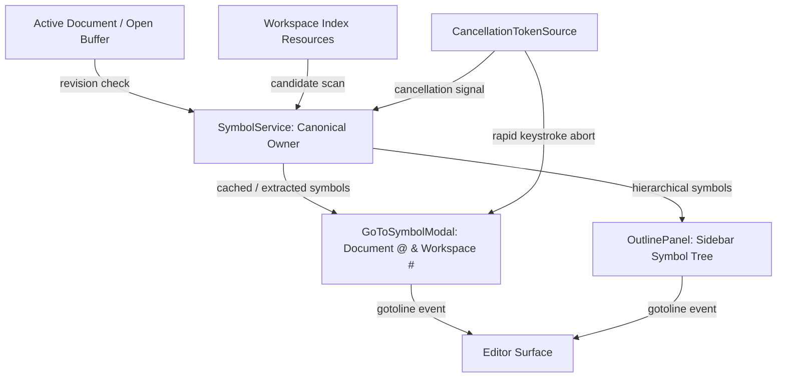

# QM Editor Symbol Infrastructure, Outline & Symbol Navigation Architecture

**Status:** Permanent Production Architecture (Phase 04, Step 35)  
**Canonical Owner:** `src/core/symbols/SymbolService.ts`  
**Downstream Consumers:** `GoToSymbolModal`, `OutlinePanel`, `Sidebar`, `CommandPaletteModal`, `QuickOpenModal`, Code Navigation

---

## 1. Executive Summary

The QM Editor Symbol Infrastructure provides a high-performance symbol indexing, document outline, and workspace symbol navigation engine. It standardizes language symbol abstractions, provides heuristic extractors for major programming and markup languages, supports hierarchical document outlines, implements real-time cancellation tokens for asynchronous queries, ensures stale-result protection across rapid user typing, and integrates symbol navigation into the application shell.

---

## 2. Core Architectural Principles

1. **Canonical Abstraction (`SymbolTypes.ts`)**:
   - Symbols follow standardized structures:
     - `DocumentSymbol`: Hierarchical representations containing `name`, `detail`, `kind`, `range`, `selectionRange`, and optional `children`.
     - `WorkspaceSymbol`: Flat workspace-wide symbol descriptors containing `name`, `kind`, `containerName`, and location (`uri` and `range`).
   - Standard LSP-compatible `SymbolKind` enumeration (`class`, `interface`, `function`, `method`, `variable`, `constant`, `enum`, `heading`, `key`, etc.).
2. **Heuristic Multi-Language Symbol Extractors (`SymbolExtractors.ts`)**:
   - TypeScript / JavaScript: extracts classes, interfaces, types, enums, functions, arrow handlers, constants, variables, and class methods.
   - Markdown: extracts heading structures (`# H1`, `## H2`, `### H3`) into nested outline trees.
   - Python: extracts `def` functions and `class` definitions.
   - JSON: extracts top-level property keys.
   - Generic fallback extractor.
3. **Revision-Aware Caching (`SymbolService.ts`)**:
   - Document symbols are cached per document ID and `contentRevision`.
   - Sequential edits invalidate the cache, but untouched buffers return cached arrays instantaneously without re-parsing.
4. **Cancellation Tokens & Stale-Result Protection (`CancellationToken.ts`)**:
   - Asynchronous workspace queries utilize `CancellationTokenSource`.
   - Typing in the symbol search box cancels in-flight extraction and query iterations immediately.
   - A monotonic `querySequence` counter guarantees that older async promises cannot overwrite newer results upon resolving.
5. **Interactive UI Integration**:
   - **Go to Symbol Modal (`GoToSymbolModal.tsx`)**:
     - Document symbols (`@` mode, `workbench.action.gotoSymbol`, shortcut `Ctrl+Shift+O`).
     - Workspace symbols (`#` mode, `workbench.action.showAllSymbols`, shortcut `Ctrl+T`).
     - Fast fuzzy search, keyboard navigation, and jump-to-source.
   - **Outline Panel (`OutlinePanel.tsx`)**:
     - Sidebar tab in primary sidebar alongside File Explorer and Source Control.
     - Real-time symbol tree with expand/collapse nodes.
     - Cursor position tracking: highlights the symbol currently enclosing the active cursor.
     - Click or keyboard activation navigates the editor to the symbol's exact line and column.

---

## 3. Class & Component Diagram



---

## 4. Key Contracts

### DocumentSymbol
```typescript
export interface DocumentSymbol {
  name: string;
  detail?: string;
  kind: SymbolKind;
  tags?: SymbolTag[];
  range: SymbolRange;
  selectionRange: SymbolRange;
  children?: DocumentSymbol[];
  containerName?: string;
}
```

### WorkspaceSymbol
```typescript
export interface WorkspaceSymbol {
  name: string;
  kind: SymbolKind;
  tags?: SymbolTag[];
  containerName?: string;
  location: {
    uri: string;
    range: SymbolRange;
  };
}
```

---

## 5. Verification & Testing

The symbol infrastructure is covered by automated unit tests in `src/core/symbols/` and `src/components/symbols/`:
- `CancellationToken.test.ts`: Tests uncancelled initial state, cancellation signals, listener dispatching, and safe disposal.
- `SymbolExtractors.test.ts`: Tests heuristic extraction for TypeScript, Markdown heading hierarchies, Python, and JSON.
- `SymbolService.test.ts`: Tests revision-keyed caching, cache invalidation, cancellation aborts, and cache disposal.
- `GoToSymbolModal.test.tsx`: Tests modal rendering and navigation props.
- `OutlinePanel.test.tsx`: Tests outline panel component rendering.
